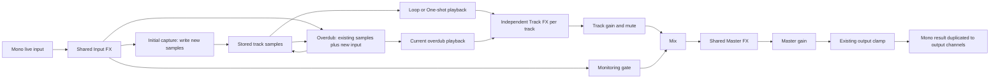

# Input, Track and Master FX design interview

Status: ready for first-filter specification synthesis. Q1–Q10 were explicitly
accepted; remaining first-delivery choices were selected under the owner's
delegation to follow the official RC-505 design. This is a design brief, not
implementation authorization. No GitHub issues have been created.

## Goal and decision discipline

Help musicians shape incoming capture, individual track playback and the final
output while preserving sample-owned timing, recording semantics and stable audio.
Prioritize simple touch controls on iPad and phone. The initial interview used one
decision at a time. The owner then delegated the remaining answers to the agent,
using the official RC-505 as reference. Preserve previously accepted choices where
LoopBeats deliberately differs from that hardware.

The completed brief is input to a later `$to-spec` invocation. The supplied
to-spec workflow does not authorize issue publication during this interview.

## Preparation and authoritative baseline

Prepared against merged main `6aba0eb`, including the Settings implementations.
Read AGENTS, glossary, README, development plan, architecture notes, both ADRs,
session export/import/conversion/recovery contracts, engine processing, browser
host/worklet bridge, and performance/Settings presentation. Historical roadmap
claims about unimplemented persistence are superseded by current code.

The local grill-with-docs wrapper references a missing local grilling folder.
The canonical primitive was found and read at the vendored upstream revision:
[skills/productivity/grilling/SKILL.md](https://github.com/mattpocock/skills/blob/d81f3a183412e71a5b1e84ca21bc1a35eea03a60/skills/productivity/grilling/SKILL.md).
The local domain-modeling skill was read. No Skill invocation tool is available;
these workflows are applied from their actual instruction sources.

Current implementation facts:

- Two tracks record mono audio. Loop playback follows one engine-owned sample
  transport; One-shot uses an independent cursor in the same engine.
- Initial capture writes incoming samples. Overdub stores the previous recording
  plus new input and plays that sum. Track gain and mute never change capture.
- Monitoring is independent of transport STOP. It joins track output before
  master gain and the final hard clamp. Existing gains have no smoothing contract.
- Rust exposes a mixed mono output. The worklet duplicates it across output
  channels. There are no independent track-output signals in the browser bridge.
- ZIP WAVs contain stored mono float32 recordings without playback gain, mute,
  normalization or output clamp. Manual export excludes unfinished initial capture.
- Recovery can freeze partial capture and overdub. This supersedes the historical
  completed-only recovery description; manual export remains completed-only.
- Import validates before atomic replacement. Conversion requires consent;
  replacement requires consent when recordings exist. Restoration is Stopped/
  Empty, transport zero, monitoring off. Recovery preserves ownership and deletion
  barriers. Canceled/rejected transactions leave the live session unchanged.
- The current version-1 manifest validates exact fields and rejects unknown
  versions. Adding FX metadata needs an explicit compatibility contract.

[Loopstation.app](https://loopstation.app/) publicly describes the three FX scopes.
It is workflow inspiration only; catalog, slot counts and detailed routing are
not verified competitor requirements.

## Confirmed decisions

Q1–Q10 below record direct owner acceptance. Their references to then-unresolved
items are superseded by the delegated decisions and final contracts that follow.

### Q1 — Recorded versus playback effects

Owner accepted the recommended distinction:

- One shared Input FX path processes incoming audio before initial capture and
  before adding new input during overdub. Its result is baked into stored samples.
- Bypassing Input FX later does not remove coloration already recorded. Subsequent
  capture follows the new setting.
- Existing stored samples never pass through Input FX again during overdub; only
  new incoming audio is processed by that path.
- Track FX affects individual playback; Master FX affects final mixed output.
  Neither rewrites stored track samples.

### Q2 — Monitoring hears processed input

Owner accepted monitoring after Input FX: performers hear the processed incoming
audio that capture receives. Monitoring off silences this listening path without
disabling capture or Input FX. A separate dry-monitoring option is not part of the
confirmed design.

### Q3 — Master FX includes monitoring; master gain is last

Owner accepted Master FX processing the mix of track playback and monitored input.
Monitoring therefore hears Input FX followed by Master FX; only Input FX is baked
into capture. Master gain follows all effects and applies to playback, monitoring
and effect tails, so zero silences all application output. Existing final clipping
protection follows master gain.

### Q4 — Track gain and mute follow Track FX

Owner accepted playback → Track FX → track gain/mute → mix. Track volume scales
both dry sound and Track FX tails. Mute silences the track's entire contribution
to the mix while playback position continues; capture remains unaffected.
This does not erase sound already accumulated in shared Master FX. Track DSP
history while muted, unmute behavior and Master tail lifecycle remain unresolved.

### Q5 — Monitoring stays independent during overdub

Owner accepted preserving the existing independent monitoring behavior. When
monitoring is on during overdub, processed new input contributes through both
the monitoring path and the overdubbing track's playback path. The latter also
passes through that track's Track FX and gain/mute. Both paths reach Master FX.
This can increase level or change coloration; starting overdub does not silently
disable monitoring. The performer can explicitly turn monitoring off.

Only incoming audio after Input FX is added to stored samples. Track playback,
Track FX and Master FX output do not feed software capture. Independent monitoring
does not cause repeated Input FX processing of existing recordings. This routing
does not prevent physical acoustic feedback from an output speaker into a microphone.

### Q6 — First delivery: one low-pass filter per scope

Owner accepted one optional low-pass filter slot for shared Input, each independent
track and shared Master. With the current two tracks this is four slots. Each
starts bypassed. The first delivery does not support multiple slots or reordering.
Delay and reverb are later deliveries, not part of the initial filter release.
Whether a later ordered-chain model is necessary remains a design question; the
first delivery does not justify implementing a general chain system.

### Q7 — Cutoff-only first filter

Owner accepted cutoff as the first filter's only adjustable sound parameter,
with a fixed non-resonant response. No resonance control is included in the first
delivery. Filter order/slope and numerical response are not established by this
decision and still need an explicit technical contract.

### Q8 — Cutoff range, default and touch control

Owner accepted cutoff in hertz from 20 Hz through
`min(20,000 Hz, 0.45 × current sample rate)`. At 48 kHz the maximum is 20 kHz;
at 8 kHz it is 3.6 kHz. A newly configured filter defaults to that upper bound
and remains bypassed initially. Enabling at the highest cutoff is still filtered
processing, not an exact dry bypass.

Use a logarithmic touch slider with visible Hz/kHz feedback to give lower
frequencies useful adjustment space. Stored precision, keyboard increments and
rounding/display rules remain open. Handling a saved cutoff above a different
host's supported range is a separate migration/conversion decision; this range
does not authorize silent clamping on import.

### Q9 — Fully filtered when enabled; dry bypass

Owner accepted no dry/wet control for the first filter. Enabled output is fully
filtered; bypass output is the dry input to that slot, with its cutoff retained.
For Track FX that dry input is the stored recording, including any baked Input FX;
it is not the original untreated microphone audio. Bypassing Input FX does not
undo coloration already captured. Master bypass does not bypass upstream FX.

Transitions and history during bypass remain unresolved. This decision does not
equate bypass with removing a filter or clearing its internal history. Later
delay/reverb dry/wet-zero semantics require their own contract.

### Q10 — Smoothed live changes

Owner accepted 10 ms smoothing for cutoff changes and a 10 ms crossfade between
filtered and dry output when toggling bypass. Changes begin when received by the
audio engine; they do not wait for loop boundaries or alter transport timing.
During capture or overdub, the Input FX transition becomes part of new stored
audio. This is a transition-duration contract, not a measured end-to-end latency
or universal click-free performance claim.

The smoothing curve, rapid successive edits, acknowledgement of target versus
current values and history while bypassed remain to be specified. Lifecycle,
persistence and device acceptance remain unresolved.

## Delegated decisions and official reference

The owner requested that the agent answer the remaining questions using the
official RC-505 design. This authorizes design choices, not code or issue creation.
Reference the original RC-505, including its documented Version 2 functionality,
not the RC-505mkII. Earlier explicit choices continue to govern this delivery.

Official reference evidence:

- [BOSS RC-505 product/support](https://www.boss.info/global/products/rc-505/support/)
  describes recording/playback FX, dedicated toggles and live parameter knobs.
- [Owner's manual](https://static.roland.com/assets/media/pdf/RC-505_e02_W.pdf),
  pp. 12 and 20–21, documents Track FX targeting, low/band/high-pass filter modes,
  cutoff, resonance and modulation controls. Page 15 describes Master compressor
  and reverb settings. Its internal bypass processing and DSP coefficients are
  not specified by these descriptions.

LoopBeats adaptations: independent per-track DSP rather than shared FX targeting;
one cutoff-only low-pass per scope; a Master filter rather than the hardware's
Master catalog; mono recordings/output processing; browser ZIP/recovery. These
follow accepted requirements and current architecture. They are not claims of
exact BOSS sonic reproduction. History, smoothing, schema and browser UI rules
below are agent-selected adaptations wherever official documentation is silent.

**Q11 resolution:** continue updating the first filter's history while bypassed.
Output is dry after its bypass crossfade; re-enabling crossfades into the response
already following the current signal. This spends processing time while bypassed
but avoids restarting a filter from unrelated or frozen history. It is not a
verified claim about BOSS's implementation.

## Complete routing

Every Track FX box is a separate instance. The shared Input filter runs once per
incoming sample, regardless of which track captures. Its result fans out to
capture/overdub and monitoring. The overdub sum is stored before Track FX. Neither
the mix nor any playback FX has a software route back to capture.

Monitoring remains independent of capture, track mute and transport STOP. During
overdub it can duplicate new-input audibility through the two accepted paths.
Master gain zero silences every output path, without clearing history. Physical
speaker-to-microphone feedback remains possible; no software resampling of
playback into capture is introduced.

## First effect and parameter contract

| Property | First low-pass filter |
| --- | --- |
| Scopes | Shared Input, each of the two tracks, shared Master; four fixed slots |
| Format | Mono capture and processing; existing duplicated output unchanged |
| Type | Optional low-pass; no other filter modes, resonance control or modulation |
| Response | Second-order low-pass, fixed Q = 1/sqrt(2); unity DC gain, approximately −3 dB at cutoff, no resonant frequency-response peak |
| Frequency | Float cutoff in Hz: 20 through min(20,000, 0.45 × host sample rate) |
| Default | Configured filter, bypassed, cutoff at the host's allowed maximum |
| Enabled output | Fully filtered, no separate dry/wet parameter |
| Bypassed output | Dry slot input; retains configuration and continuously updated history |
| Cutoff edits | Linear movement in log-frequency over ceil(sampleRate × 0.010) samples |
| Bypass edits | Linear dry/filtered amplitude crossfade over the same sample count |
| Successive edits | Retarget from the current interpolated value/mix; latest accepted target wins, no restart from an old endpoint |
| Units after rate change | Keep Hz when valid; rebuild coefficients/history for the host rate; consent rule below applies when above its maximum |
| Storage cost | Constant-size coefficients, history and ramp state per slot; no recording-sized or delay buffers |
| CPU cost | Four mono filter instances plus smoothing; bypass still processes; actual processing/update cost must be measured |

The response uses a conventional biquad low-pass derived from the
[W3C Audio EQ Cookbook](https://www.w3.org/TR/audio-eq-cookbook/). This is a
LoopBeats algorithm choice, not a reconstruction of proprietary BOSS DSP.
Coefficient/state arithmetic must remain finite and stable across supported rates
and rapid edits. The implementation must verify stability rather than assume
arbitrary coefficient interpolation is safe. Float64 intermediate DSP arithmetic
and float32 recorded/output samples provide an explicit initial numerical model.

Filtering can change phase and produce transient overshoot. No normalization,
capture clamp or look-ahead latency compensation is added. Preserve finite
over-range stored samples and apply the existing final output clamp only after
master gain. Unsupported/invalid live commands return a visible error and retain
the last valid acknowledged configuration. If DSP output becomes non-finite,
fail closed through the audio-error lifecycle rather than recording/outputting
NaN or silently reporting successful processing.

The filter's small decaying history is still DSP history; it is not treated as
delay/reverb-style spillover. No history reset occurs at ordinary Loop boundaries.
Delay and reverb are later catalog entries, with no approved DSP or parameter
ranges in this first specification. Their time/feedback/wet controls, algorithms,
stereo behavior, buffer bounds and tails require separate specifications and
device evidence; do not invent hardware parameter ranges or implement them now.

## Bypass, history and removal

- **Bypass:** select dry slot output via the accepted crossfade, retaining cutoff
  and continuing the filter's state updates.
- **Wet zero:** a future mix parameter; it does not inherently disable processing,
  erase buffers or remove configuration. The first filter has no wet control.
- **Clear history:** discard only transient DSP state; retain type, cutoff and
  bypass configuration. This is an internal lifecycle operation, not a first-
  delivery user-facing button.
- **Remove:** acknowledge and persist target None at command acceptance, while
  the old filter finishes a 10 ms crossfade to dry. Its retained DSP state is
  transient, not archived configuration. Then clear its state and mark the
  structural transition complete. Adding a filter again uses the brightest
  default and starts bypassed.

For this first delivery, reject another type/add/remove, cutoff or bypass command
for the same slot during that 10 ms removal with an explicit temporary-busy result;
do not queue it or apply it later. Other slots and performance commands remain
available. The editor indicates this short structural transition. After completion
a new add command is accepted normally. No delayed completion may erase a newer
configuration. Export/recovery during the fade sees target None and stored audio,
never the retiring filter state. A lifecycle clear completes removal immediately.

The first slot supports None and Low-pass. Replacement with delay/reverb and
reordering do not exist in the first delivery. Parameter edits during capture
remain permitted; only subsequent Input-processed samples reflect the edit.

## Lifecycle and history rules

These rules are LoopBeats adaptations. A local action must not erase another
track's history or indiscriminately reset shared Master processing.

| Action | Input FX history | Affected Track FX history/output | Master FX history/output |
| --- | --- | --- | --- |
| Enable/bypass | Continue; 10 ms crossfade | Continue; 10 ms crossfade | Continue; 10 ms crossfade |
| Cutoff edit | Continue with smoothed parameter | Same, only selected track | Continue with smoothed parameter |
| Start/end initial capture or overdub | Continue following live input | New playback starts from fresh state after Empty/Stopped; finishing overdub keeps ongoing state | Continue |
| Ordinary Loop boundary | Continue | Continue, never reset each cycle | Continue |
| Track STOP | Continue for monitoring/future capture | Silence and clear this track immediately; retain FX configuration | Continue for other tracks/monitoring; previously mixed filter residual can decay |
| Natural One-shot completion | Continue | Process and contribute the final recorded sample, then clear; zero track contribution from the next sample | Continue; existing mixed residual may decay |
| One-shot retrigger | Continue | Reset selected track history and replay from sample zero | Continue |
| Track mute | Continue; capture unaffected | Keep processing at advancing playback position, but gate all its output after FX | Continue; already mixed sound cannot be selectively removed |
| Track unmute | Continue | Reveal current evolving response, not frozen history | Continue |
| Track volume zero | Continue | Keep processing; gate all selected track output | Continue; existing mixed residual may decay |
| Master gain zero | Continue | Continue | Continue internally; final output is exactly silent |
| Monitoring off | Continue; capture unaffected | Unchanged | Stop receiving monitoring; previously mixed filter residual may decay |
| Global STOP | Clear transient history; live input then resumes processing | Clear all track histories; stop every track under existing rules | Clear history at STOP; may immediately process fresh monitored input if monitoring remains on |
| CLEAR track | Continue | Clear history and silence; retain this slot's type/cutoff/bypass for rerecording | Continue for surviving sources; no promise of selective Master-history removal |
| Reset session | Clear; reset FX configuration to defaults | Clear all histories/configurations to default bypassed filters | Clear/configuration defaults; monitoring is off |
| Stop audio/discard session | Clear/dispose configuration and history | Same | Same; no output; a new audio session starts default bypassed filters |
| Interruption/reinitialization | Clear history on interruption; retain configuration and resume the same host/engine | Retain completed recordings and overdub additions; discard unfinished live initial capture under existing rules; fresh history, stopped | Clear history; retain configuration; monitoring off |
| Successful input switch | Clear at the processing-side STOP command after source replacement; retain configuration | Clear all track histories; retain completed recordings/configuration; tracks stay stopped | Clear at that STOP boundary; monitoring setting is retained and the new source resumes processing |
| Failed/abandoned input switch | No switch-induced history or configuration reset; old live source continues if lifecycle remains valid | No switch-induced reset | No switch-induced reset; a separate interruption/Stop audio still follows its own rule |
| Successful import/recovery | Install configuration with fresh history | Install atomically with fresh history and Stopped/Empty tracks | Install configuration with fresh history; monitoring off |
| Rejected/canceled import/recovery | No transaction-induced change | No transaction-induced change | No transaction-induced change |

Global STOP silences track performance and its prior FX history; it does not turn
off explicitly enabled live monitoring. A completely silent output is obtained
with monitoring off or master gain zero. Reset additionally resets FX because
FX belongs to the session; existing retained mode/gain/mute preferences are
unchanged. Update reset consequences in the UI accordingly.

Whenever a lifecycle action clears a slot's history, also cancel its active
parameter/bypass ramps and set their current values to the last accepted targets.
Do not resume an old ramp after STOP, CLEAR, One-shot end/retrigger, successful
input switching or interruption. Configuration-reset actions instead install
the default targets. Successful import/recovery installs imported targets directly.
Muted, zero-volume and bypassed processing keeps ordinary ramps progressing.
Lifecycle clears are immediate state boundaries, not extra 10 ms audio fades.
Ordinary Loop wrap and PLAY of an already-playing Loop do not clear history/ramps.

Current input switching retains the AudioContext/engine, requires stopped playback,
capture and transport, and reconnects its source before sending Global STOP.
History clears when that command executes; no stronger atomic source-swap claim is
made. Distinguish browser source selection from processing-side reset acknowledgement.
Failed switching does not dispatch that reset. Current reinitialization also resumes
the same context/engine; a closed context cannot retain/reinitialize that session.
Rate-changing engine reinitialization and retained-recording migration are outside
this delivery. A prior partial recovery checkpoint remains separately recoverable
even when interruption discards unfinished live capture.

Existing confirmation, recovery-deletion barriers, ownership, source retention
and failed-action behavior apply before any destructive history/configuration
change. A failed deletion must not clear FX history or partially reset the session.
Independent live audio progression while a transaction is pending is not undone.

## Session ownership, schema and export

FX configurations belong to the session, not global application preferences.
Do not restore them from localStorage or silently overwrite recovered/imported
configuration with device preferences. No presets/library are included.

Write portable archive version 2, retaining the existing ZIP/WAV conventions and
limits. Add `inputFx` and `masterFx` slot configurations to session metadata and
`fx` to each ordered track configuration. Type, bypass and cutoff are
saved. Scope is encoded by the metadata location, and order is always the one
fixed slot at position zero; redundant scope/order/enabled fields are unnecessary.
The slot's `type` is `None` or `LowPass`. None has no cutoff or bypass fields.
LowPass has exactly `type`, boolean `bypassed` and finite `cutoffHz`. Do not
serialize coefficients, ramp positions,
filter history or device/monitoring state.

Readers support versions 1 and 2 through explicit validation/migration. Version 1
loads with default bypassed filters and fresh history. Version 2 must include all
four scoped configurations, even for Empty or omitted unfinished tracks. Old
readers reject version 2; there is no implicit downgrade or loss of FX settings.
Unknown archive versions/effect types, duplicate/wrong scopes, missing/unexpected
fields, non-finite or out-of-range parameters reject the entire load, even for a
bypassed effect. Do not silently discard unknown effects or clamp invalid files.

Version-2 cutoffs must be valid for the source sample rate. When the target rate
changes, valid Hz values are preserved. If a valid source cutoff exceeds the
target maximum, include the affected scopes and old/new cutoff values in the
existing conversion warning; only after consent cap it to the target maximum.
Cancellation leaves the live session unchanged. Rate changes in this delivery
occur by starting a new host and importing/recovering through the existing
conversion transaction, not by migrating a running engine during reinitialization.
All histories and coefficients are rebuilt for the new rate. Time-valued
delay/reverb parameters will remain in time units when their later specifications
are written.

Keep same-rate raw stored samples unchanged through ZIP round trips. Input FX
coloration is already stored audio; do not apply it again on export, import or
recovery. Track/Master FX is configuration for playback, not a rendered WAV mix.
Rendered mix export remains a separate deferred feature.

FX metadata and recordings install in the same engine-owned atomic commit.
Validate/stage all metadata outside processing, independently validate commands
in Rust, and preflight capacity before replacement. FX state is fixed-size;
allocate no new recording bank. The commit installs target values directly with
fresh history because playback is stopped; no startup transition from discarded
session configuration is needed.

Explicit valid FX commands participate in the existing import command-revision
guard. A live FX edit during staging/confirmation invalidates import rather than
overwriting that edit. Export freezes configuration at its acknowledged snapshot;
later playback-FX edits do not tear archived metadata or stop live playback.
Recovery freezes configuration at the same boundary as audio and includes changes
in its dirty revision. Ramp progress alone is not a new dirty change. Persist the
accepted target values, not temporary interpolated values.

Keep recovery's existing database/envelope version 1 if only its contained archive
changes; explicitly accept supported v1/v2 contained archives. Existing pending
records, ownership and deletion ordering survive this update. Never rewrite a
pending old-workspace record merely to migrate it. Successful recovery and the
next ordinary checkpoint can save the migrated session in the new archive format.

## Performance UI contract

Use the hardware's direct on/off-and-primary-control idea, adapted for touch:

- Keep a visible compact FX button/state for Input and Master near master controls,
  and for each track within its strip. Label scope and Bypassed/On/None plainly.
- Open a nonmodal inline Effects editor with explicit Input, Track 1, Track 2 and
  Master selectors. Always show the selected scope in its heading. Scope selection
  itself never changes processing or bypass state.
- Provide a large On/Bypass toggle, low-pass cutoff slider and current Hz/kHz
  value. Type selection is limited to None/Low-pass. No hover-only actions,
  rotary gestures, momentary activation or preset controls.
- Use a logarithmic slider with 1,000 equal travel increments. Home/End select
  bounds; native arrow keys step one increment. Provide −/+ buttons for one-
  twelfth-octave changes, capped at bounds, to avoid precise dragging on phones.
  Preserve numeric Hz precision in the session; display whole Hz below 1 kHz
  and two-decimal kHz at/above 1 kHz. Display rounding does not alter saved values.
- Touch targets are at least 44 × 44 CSS pixels. At 320 CSS pixels, controls wrap
  without horizontal scrolling. Keep REC/PLAY and STOP reachable without closing
  a modal FX screen; the editor must not cover or make performance controls inert.
- Use an expandable details section for explanatory text. There are no advanced
  sound parameters in the first filter. Closing the editor never changes audio.
- Show acknowledged target parameters/bypass from the engine. Distinguish pending
  commands and errors; during the 10 ms transition an accepted target is not a
  claim that the instantaneous DSP value has already reached it. Coalesce rapid
  slider targets rather than queue an unbounded command backlog.
- Before audio is ready, scope navigation is available but processing edits are
  disabled with an explanation. New engine initialization supplies rate-dependent
  defaults. Initial editor scope is Input and the choice is remembered this visit.
- Escape closes the editor and returns focus to its opener; this does not stop
  capture or playback. Scope and parameter controls have keyboard labels/focus.

## Architecture decision and constraints

Use Rust DSP inside the existing shared LoopEngine. Web Audio remains the browser
I/O host; the worklet translates bounded commands and blocks. React owns accessible
controls and approximate visuals, never sample timing or DSP history. See
[ADR-0003](../adr/0003-engine-owned-effects.md).

| Option | Trade-off against the existing code |
| --- | --- |
| Rust DSP | Input/capture and independent tracks already meet here; preserves portable DSP, one sample clock and atomic configuration restoration; requires algorithm and measurement work |
| Web Audio nodes | Convenient browser effects, but current mixed/clamped output cannot recover independent track signals; Input capture routing and master-last gain would require graph/bridge changes |
| Hybrid | Possible later, but splits history/lifecycle/serialization ownership and requires coordinated routing; no first-filter benefit sufficient to justify it |

Use four fixed optional slots, not a generic ordered-chain/plugin abstraction.
History/coefficient/ramp storage is allocated with engine initialization. Processing
and REC do not allocate or free, block, serialize, perform I/O or depend on React.
Messages, snapshots and persistence stay at existing controlled seams. Changing a
parameter does not reset the sample clock or recording/playback cursors.

## Verification and measurement acceptance

The primary behavioral seam is public engine commands/process/snapshot, supported
by actual AudioClient/worklet/WASM and observable production-browser workflows.
No new per-track browser-output seam is required for this architecture.

| Scenario | Required evidence |
| --- | --- |
| Input filter baked into capture | Literal impulse/sinusoid fixtures; bypass later leaves stored samples unchanged, subsequent capture is dry |
| Overdub processes input once | Stored base plus exactly one filtered addition; no filter pass over prior samples across repeated overdub cycles |
| Track independence | Change Track 1 FX; Track 2 configuration/output and both stored recordings remain unchanged |
| Master routes intended sources | Known track and monitored-input signals processed through Master; no stored-sample mutation |
| Bypass and rapid retargeting | Sample-counted 10 ms ramps, final dry sample equality, continuous state through bypass, deterministic last-target handling across different block lengths |
| Response and numerical safety | DC/silence, expected cutoff response (−3.0103 dB ±0.1 dB after settling), pass/stop-band response, impulse decay, finite over-range inputs; rates 8/44.1/48/192 kHz and cutoff extrema |
| Timing and silence | Long Loop phase, One-shot exact completion, unaffected cursors during rapid edits; master gain zero produces zero output with nonzero internal history and monitoring |
| Lifecycle | Test every row and mid-ramp clears, successful/failed/abandoned input switching, local/shared history, mute advancing, CLEAR generation reuse, confirmation cancellation and deletion failure; include a one-sample One-shot to prove its final sample is filtered before clearing |
| Session/recovery | Independently inspect v2 ZIP and raw WAVs; v1 migration, strict invalid/unknown rejection, fresh histories, consistent checkpoints, cancellation and late mutation races |
| Rate conversion | Preserve valid Hz; explicit warning/consent for affected cutoff caps, cancellation, coefficients rebuilt, shared timing retained |
| UI | Actual production controls, scope identity, On/Bypass/None, 320px/iPad layouts, touch target geometry, keyboard/zoom/reduced motion and reachable performance controls |

Before final device limits are claimed, measure baseline and four-filter workloads:
both tracks populated to existing capacity, playback/overdub, monitoring on, all
filters active or bypassed with state updates, rapid cutoff/bypass edits, automatic
checkpointing and 30 seconds of busy UI during a 10-minute playback run. Report
sample rate, block size, added WASM memory, processing-time distribution/max and
observed deadline misses/glitches. Include pure processing at supported rate extremes
and actual browser/host rate combinations; distinguish synthetic from physical data.

Hard initial scope limits are two tracks/four mono slots and existing recording/
archive limits. No effect-sized delay buffers or general chain allocation exists.
CPU headroom and supported device configurations must come from measurements;
do not claim an invented universal latency target, CPU percentage or glitch-free
guarantee. If measured processing cannot meet the host block budget, the affected
configuration is not accepted until fixed or explicitly restricted.

Automated tests, required static/build checks and code/spec review gate feature PRs.
Consolidate focused physical listening/load checks for desktop Chrome with wired
audio, iPad Safari and a phone browser (iPhone Safari first); record build, hardware,
OS/browser, rate, audible clicks/dropouts and limitations. Effects/mobile acceptance
is a new evidence requirement; do not reopen or silently extend closed #19 or claim
its desktop report validates new FX. A failing affected physical configuration
blocks that device claim, not unrelated implementation. No hardware test has run
as part of this documentation task.

## Deferred scope and unresolved evidence

Deferred: delay/reverb DSP and parameter contracts, stereo recording or stereo
effect output, additional slots/order changes, presets, momentary activation,
modulation/automation, pitch/time processing, plugin hosting, marketplaces/cloud,
MIDI FX controls, global FX preferences and rendered mixed-output export.
Rate-changing reinitialization of a retained live engine is also deferred; session
import/recovery conversion remains supported as specified above.
These are explicit exclusions from the first-filter specification, not silently
assumed requirements for later releases. Delay should precede reverb after device
measurement, using new specifications for buffer and tail behavior.

No owner behavior question remains for the first-filter brief under the delegation.
Unmeasured facts remain: supported device/browser versions, actual CPU/headroom,
memory overhead, perceived transition quality and whether future stereo/long tails
fit device budgets. Detailed internal coefficient update optimization is an
implementation choice constrained by the response, smoothing and stability tests.
No numerical performance evidence or proprietary BOSS algorithm is inferred.

## Small delivery slices for to-spec

1. Specify and test fixed FX configuration, filter response, transition/history
   model and engine-owned commands at existing seams. Keep production UI gated.
2. Add shared Input processing/capture and processed monitoring, including exactly-
   once overdub tests. Preserve all existing recording timing.
3. Add independent Track and shared Master processing, master-last gain and all
   lifecycle tests. Keep the single-slot scope.
4. Integrate archive v2/v1 migration, atomic import, conversion adjustments and
   recovery consistency before any user-facing FX release. Do not ship editable
   session FX while ZIP/recovery silently drops them.
5. Deliver the touch editor and integrated production-browser/load verification;
   perform the focused physical FX acceptance run and document supported setups.
6. Later: separately specify delay, then reverb; consider slots/stereo only after
   evidence. There is no issue creation or implementation authorization here.

The first five slices form one coherent filter delivery; they are proposed
specification/ticket boundaries, not published tickets. This brief is ready for
`$to-spec` synthesis when explicitly requested. Issue publication remains outside
this documentation task.
